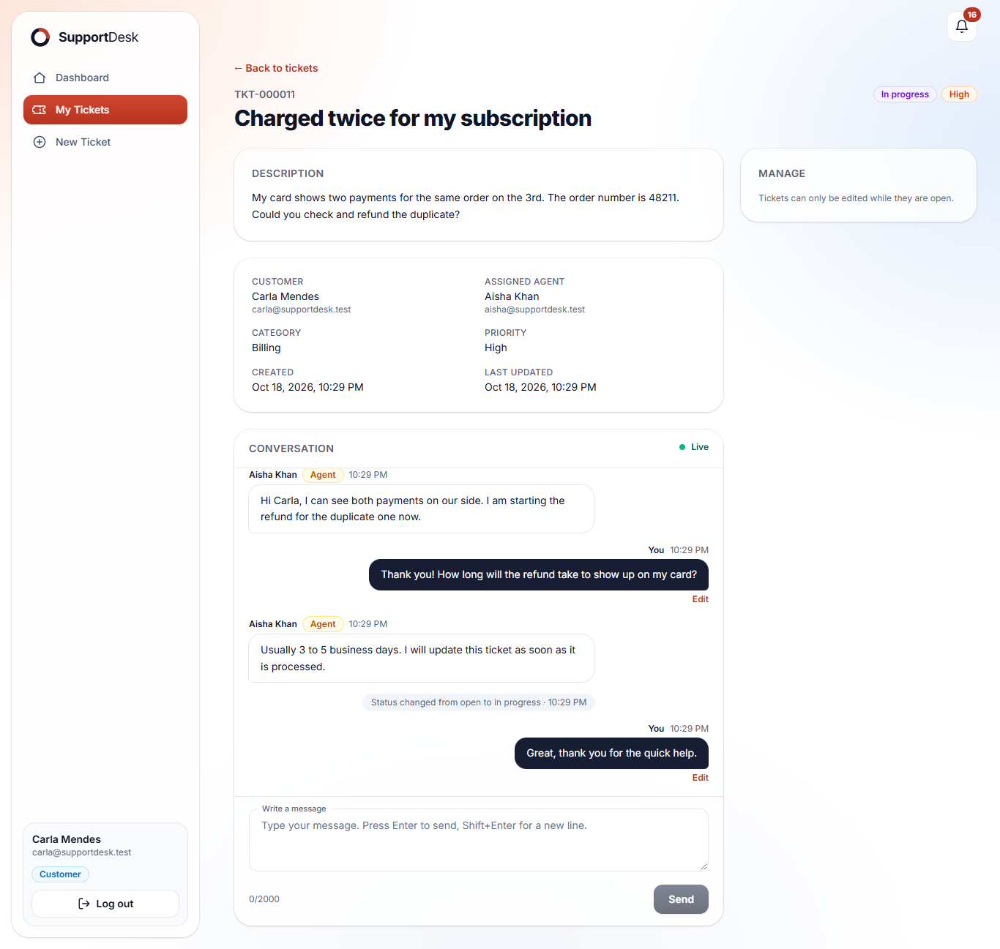
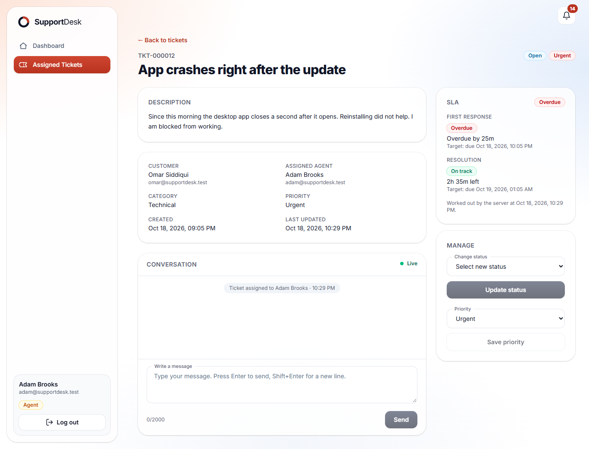
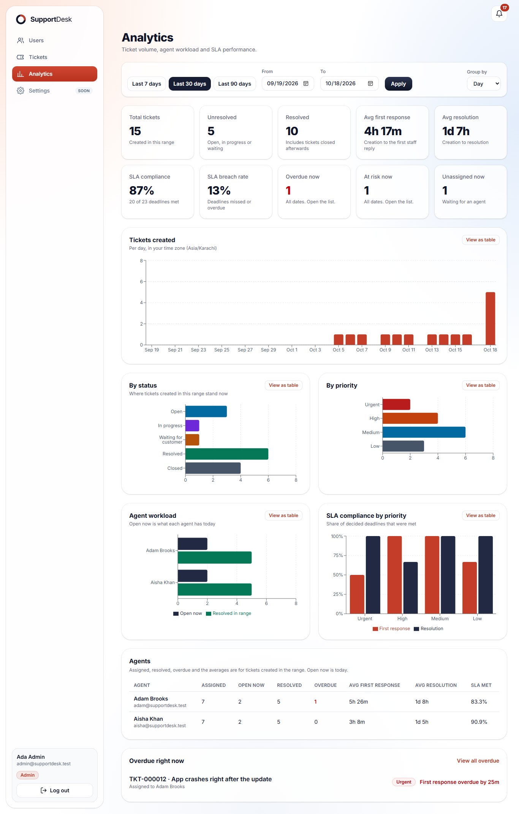
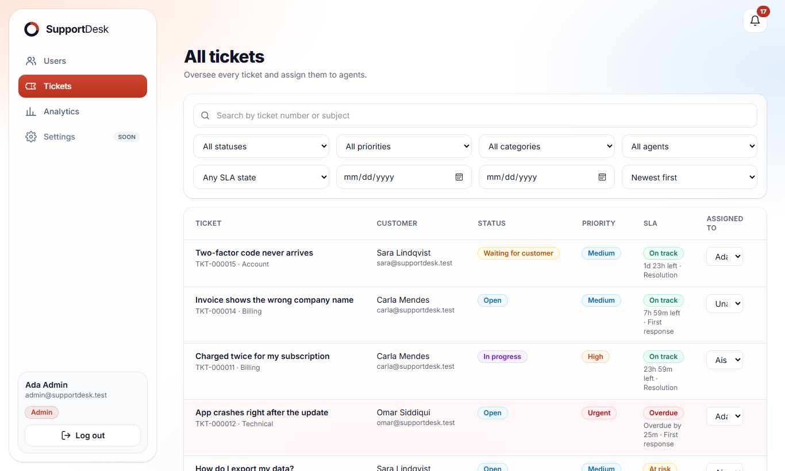
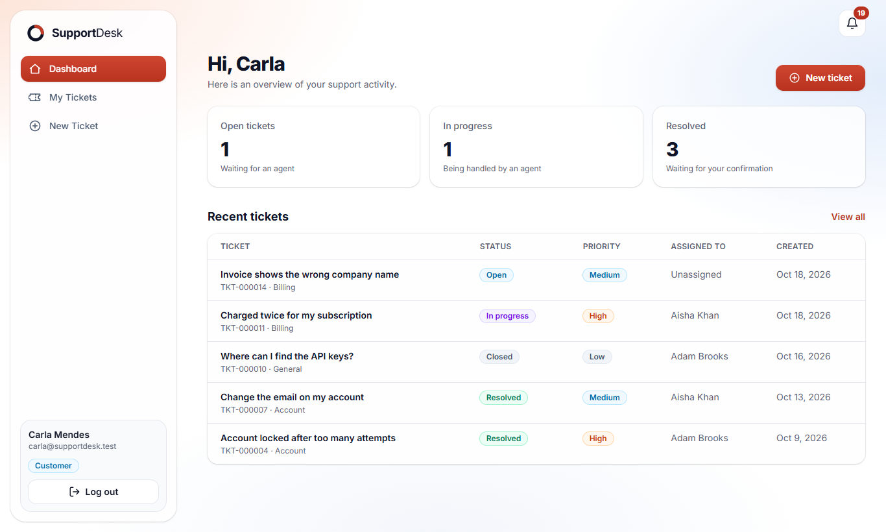
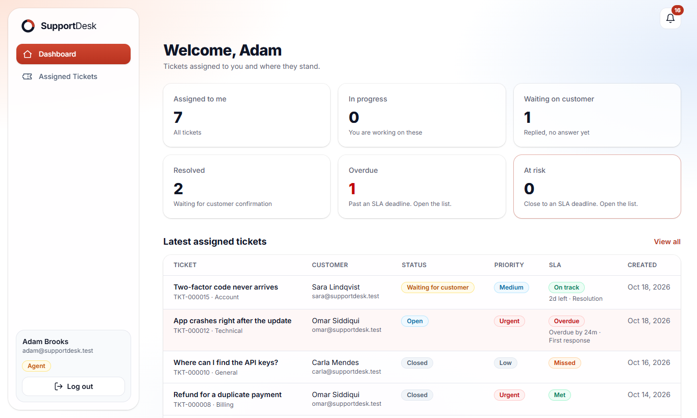
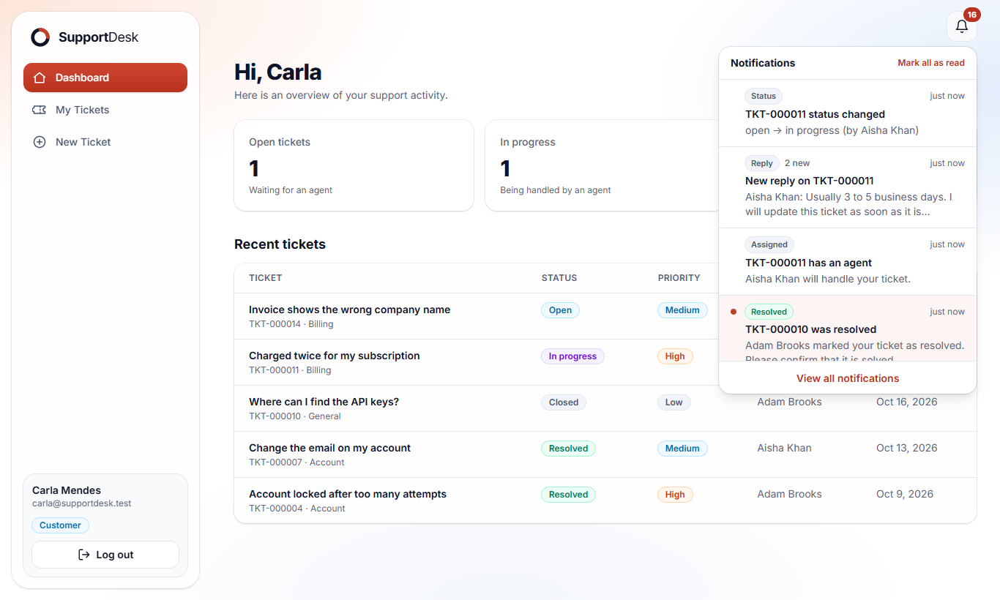
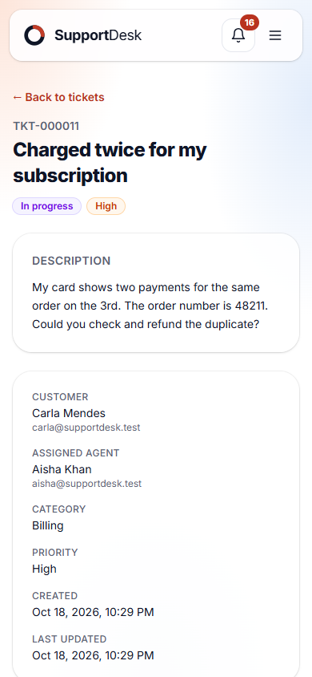
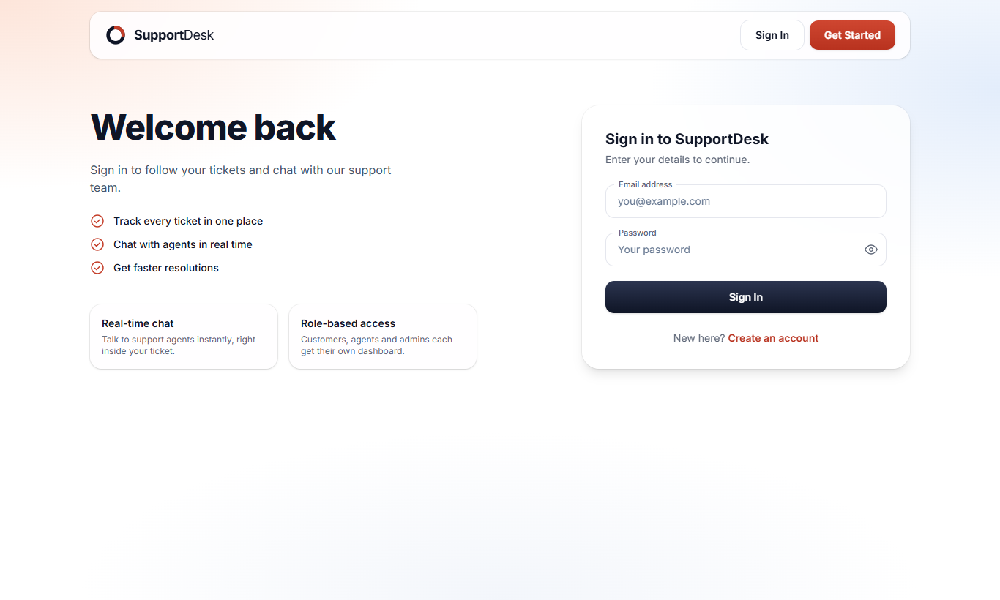

# SupportDesk: Real-Time Customer Support & Ticketing System

SupportDesk is a full-stack help desk. **Customers** open tickets and follow them, **agents** work the tickets assigned to them and talk to the customer in real time, and **admins** assign tickets and watch volumes, workloads and SLA compliance. Notifications and the conversation update live over WebSockets.

| | |
|---|---|
| Web app (Vercel) | https://customer-support-system-ten.vercel.app |
| API (Render) | https://customer-support-system-api-1qcu.onrender.com/api |
| Health check | `GET /api/health` (database state, version, uptime) |
| Repository | https://github.com/Web-3-Geeks/customer-support-system |

> The API runs on a free Render instance, which sleeps after 15 minutes without traffic. The first request after a pause can take up to a minute; an uptime monitor pinging `/api/health` every 5 minutes keeps it awake (see [Deployment](#deployment)).

## Screenshots

| Customer: ticket with live conversation | Agent: ticket with its SLA card |
|---|---|
|  |  |

| Admin: analytics | Admin: all tickets |
|---|---|
|  |  |

| Customer dashboard | Agent dashboard (overdue and at-risk cards) |
|---|---|
|  |  |

| Notifications | Phone (390 px wide) | Login |
|---|---|---|
|  |  |  |

The screenshots were taken from the real application running against a throwaway database filled with demo data.

## What it does

- **Customer:** register, create a ticket, see only their own tickets (search, filters, sorting, pages), edit or cancel while it is open, chat with the assigned agent, confirm and close a resolved ticket, get notified about every step.
- **Agent:** see the tickets assigned to them, change status along the allowed path, change priority, reply in real time, see the SLA clock of each ticket, and get alerts when a ticket is at risk or overdue.
- **Admin:** see every ticket, assign and reassign agents, change priority and category, manage user roles, and review analytics: ticket volume over time, status / priority / category breakdowns, agent workload and performance, SLA compliance and the list of overdue tickets.
- **Everyone:** live notifications with a bell and an unread count, a live connection indicator, and an interface that works on a phone and with a keyboard.

## Tech stack

- **Backend:** Node.js 20+, Express 5, MongoDB (Atlas) with Mongoose 8, Zod validation, JWT, bcrypt, Helmet, CORS, express-rate-limit, Socket.IO
- **Frontend:** React 19, Vite, Tailwind CSS 4, React Router 7, Axios, socket.io-client, Recharts
- **Tests:** Jest + Supertest + socket.io-client on an in-memory MongoDB (backend), Vitest + Testing Library (frontend)
- **Hosting:** Render (API and sockets), Vercel (web app), MongoDB Atlas (database)

## Quick start

Requirements: Node.js 20 or newer, and a MongoDB database (a free Atlas cluster is enough).

```bash
git clone https://github.com/Web-3-Geeks/customer-support-system.git
cd customer-support-system

# 1. Backend
cd backend
cp .env.example .env          # fill in MONGO_URI, JWT_SECRET, ADMIN_* (see the tables below)
npm install
npm run seed:admin            # creates the first admin account from the ADMIN_* variables
npm run dev                   # API and sockets on http://localhost:5000

# 2. Frontend (a second terminal)
cd frontend
cp .env.example .env          # VITE_API_URL=http://localhost:5000/api
npm install
npm run dev                   # web app on http://localhost:5173
```

Log in with the admin from the seed step. Register a customer in a second browser, and promote another registered user to `AGENT` from the admin's **Users** page to try the whole flow with three roles.

### Scripts

| Where | Command | What it does |
|---|---|---|
| backend | `npm run dev` | Start with automatic restart (nodemon) |
| backend | `npm start` | Start for production |
| backend | `npm test` | Run the backend tests (in-memory database, never touches real data) |
| backend | `npm run seed:admin` | Create the first admin; add `-- --reset-password` to reset its password |
| backend | `npm run backfill:sla` | Give tickets that pre-date SLA tracking their deadlines (the server also does this on start) |
| frontend | `npm run dev` / `npm run build` / `npm run preview` | Develop, build for production, preview the build |
| frontend | `npm test` / `npm run lint` | Run the tests / the linter |

### Environment variables

Both apps have a documented template: [backend/.env.example](backend/.env.example) and [frontend/.env.example](frontend/.env.example). Real values live only in `.env` files (ignored by git) or in the hosting dashboards.

**Backend**

| Variable | Required | Description |
|---|---|---|
| `MONGO_URI` | yes | MongoDB connection string |
| `JWT_SECRET` | yes | At least 32 random characters (the server will not start in production with a shorter or placeholder value) |
| `JWT_EXPIRES_IN` | yes | Token lifetime, for example `7d` |
| `CLIENT_URL` | yes in production | Exact origin of the web app, no trailing slash. It is the only origin allowed by CORS and by the socket server |
| `NODE_ENV` | no | `production` on the host. Switches on strict startup checks and JSON logs |
| `PORT` | no | Defaults to `5000`; hosts such as Render set it themselves |
| `LOG_LEVEL` | no | `error`, `warn`, `info` (default) or `debug` |
| `SLA_CHECK_INTERVAL_MS` | no | How often the SLA worker runs (default `60000`) |
| `ADMIN_NAME`, `ADMIN_EMAIL`, `ADMIN_PASSWORD` | seed only | Used by `npm run seed:admin` |

**Frontend**

| Variable | Description |
|---|---|
| `VITE_API_URL` | Base URL of the API including `/api`. The socket connects to the same host without `/api` |
| `VITE_SOCKET_URL` | Optional. Only when the socket server is on a different host |

On start the backend checks its configuration. In production a missing `MONGO_URI`, `JWT_SECRET` or `JWT_EXPIRES_IN`, a short or placeholder secret, a `CLIENT_URL` that is missing, is not a URL or ends with a slash, or a non-numeric `PORT` stops the server with a clear message instead of causing a strange CORS or login problem later. In development the same problems are warnings (except the settings that break everything).

### Database setup

There are no migrations. MongoDB collections and their indexes are created automatically the first time the server runs (Mongoose builds the indexes declared in the models). After that:

1. `npm run seed:admin` creates the first admin (there is no sign-up path to `ADMIN`).
2. Tickets created before SLA tracking were added get their deadlines on the next start, or with `npm run backfill:sla`.
3. Indexes that an earlier version created and the current models no longer declare are not removed automatically. They are harmless; drop them in Atlas if you want to save the space.

## Roles and permissions

| Action | Customer | Agent | Admin |
|---|---|---|---|
| Register / log in / see own profile | yes | yes | yes |
| Create a ticket | yes | no | no |
| See tickets | own tickets | tickets assigned to them | all |
| Edit subject, description, category | own, while `OPEN` | no | category only |
| Change priority | no | assigned tickets | all |
| Change status | cancel (`OPEN` to `CLOSED`), confirm (`RESOLVED` to `CLOSED`) | along the lifecycle, assigned tickets | all |
| Assign / reassign agents | no | no | yes |
| Read and write messages | own tickets | assigned tickets | all (read and write; edits only by the sender) |
| See SLA data | no | yes | yes |
| Notifications | own | own | own |
| Change user roles, list users, analytics | no | no | yes |

A ticket outside a person's scope answers `404` (its existence is not revealed); an action their role may never perform answers `403`; a status move that does not exist answers `400`. The file `backend/tests/accessMatrix.test.js` checks every endpoint against every kind of person.

## SLA rules

Every ticket gets two deadlines when it is created, counted in calendar hours (24/7) from creation. They depend on the priority and are recalculated when the priority changes.

| Priority | First response | Resolution |
|---|---|---|
| `URGENT` (critical) | 1 hour | 4 hours |
| `HIGH` | 4 hours | 24 hours |
| `MEDIUM` (the default) | 8 hours | 48 hours |
| `LOW` | 24 hours | 120 hours |

- The **first response clock** stops at the first message from staff. The **resolution clock** stops when the ticket is resolved.
- Each clock is `ON_TRACK`, `AT_RISK` (a quarter of the time or less is left), `BREACHED` (deadline passed, still running), `MET`, `MISSED` (stopped after the deadline) or `NOT_APPLICABLE` (the ticket was cancelled before it started).
- Staff get an `sla` block on tickets, including `serverTime`, so the browser counts down from the server's clock and a wrong PC clock cannot change what is shown. **Customers never see SLA data.**
- A background worker inside the API process runs every 60 seconds, finds tickets that became at risk or breached, and notifies the assigned agent and the admins. Each alert is claimed with one atomic database update, so it is sent at most once, even with several server instances.

## Notifications

Every notification belongs to one user, is stored (so it is there after a refresh) and is also pushed live over the socket. The person who caused an event is never notified about it.

| Type | Who gets it |
|---|---|
| `TICKET_CREATED` | Admins |
| `TICKET_ASSIGNED` | The new agent and the customer |
| `STATUS_CHANGED` | The customer, and the assigned agent when someone else changed the status |
| `TICKET_RESOLVED` | The customer, asking them to confirm |
| `NEW_REPLY` | The other side of the conversation |
| `SLA_AT_RISK`, `SLA_BREACHED` | The assigned agent and the admins |

- Replies are **grouped**: one unread `NEW_REPLY` per user and ticket, with a count ("3 new replies"), so a long chat does not flood the bell.
- Opening a ticket marks that ticket's notifications as read; read state is kept in sync across a user's tabs.
- Creating a notification is best-effort: if it fails, the failure is logged and the ticket change or message still succeeds.
- A notification is deleted automatically 90 days after its last event, and when a ticket is reassigned the previous agent's notifications about it are removed (they contain message previews).

## Analytics

Admin only (`/api/admin/analytics/*`), computed with MongoDB aggregation, never by loading tickets into memory.

- **Range:** `from` and `to` (`YYYY-MM-DD` or an ISO timestamp), default the last 30 days, at most 366 days. `tz` is any IANA time zone name in any letter case (default `UTC`); days and weeks are cut in that zone. `interval` is `day`, `week` or `month`.
- **What the figures mean:** they describe tickets **created in the range**. Average first response is creation to the first staff reply; average resolution is creation to resolved. The exceptions are the "right now" figures (overdue, at risk, unassigned, open now), which look at all tickets today, whatever the range.
- **Endpoints:** `overview` (totals, averages, SLA compliance and breach rate, right-now figures), `tickets` (created per bucket, zero-filled, plus status / priority / category breakdowns), `agents` (assigned, resolved, overdue, open now, averages and SLA per agent) and `sla` (met / missed / breached by priority and the list of overdue tickets).

## Conversation rules

| Rule | Behaviour |
|---|---|
| Who can read and write | The ticket's customer, its assigned agent and admins. Everyone else gets `404` (the ticket's existence is not revealed) |
| Message size | 1 to 2000 characters after trimming. Empty or whitespace-only messages are rejected |
| Closed tickets | No new messages and no edits (`400`). The history stays readable |
| Who can edit | Only the sender, only `TEXT` messages, only within 15 minutes of sending (`editableUntil` in the message). Not even an admin can edit someone else's message (`403`). System lines can never be edited |
| Edited messages | `editedAt` is set and the UI shows "(edited)". Sending the same text again changes nothing |
| Delete | Not offered, so the conversation stays an honest record |
| Sender | Always the logged-in user. `senderId` and `messageType` in the request body are ignored, so nobody can post as someone else or fake a system line |
| Rate limit | 20 messages or edits per minute per user (`429`). Reading is not limited |
| A message from another ticket | Editing a message through the wrong ticket returns `404` |

## Ticket lifecycle and rules

Statuses: `OPEN`, `IN_PROGRESS`, `WAITING_FOR_CUSTOMER`, `RESOLVED`, `CLOSED`.

| From | To | Who can do it |
|---|---|---|
| `OPEN` | `IN_PROGRESS` | Agent (assigned to the ticket), Admin |
| `OPEN` | `CLOSED` (cancel) | Customer (own ticket), Admin |
| `IN_PROGRESS` | `WAITING_FOR_CUSTOMER`, `RESOLVED` | Agent, Admin |
| `WAITING_FOR_CUSTOMER` | `IN_PROGRESS`, `RESOLVED` | Agent, Admin |
| `RESOLVED` | `CLOSED` (customer confirms) | Customer, Admin |
| `RESOLVED` | `IN_PROGRESS` (reopen) | Agent, Admin |
| `CLOSED` | none | Closed tickets are final |

Other rules:
- **Customer edits:** `subject`, `description` and `category` can only be changed while the ticket is `OPEN`. Customers cannot change the priority (new tickets start as `MEDIUM`).
- **Agents** can change the priority of their assigned tickets. **Admins** can change the priority and category of any ticket.
- A ticket needs an assigned agent before it can move to `IN_PROGRESS`.
- Tickets can only be assigned to users with the `AGENT` role. Closed tickets cannot be reassigned or modified.
- An agent's role cannot be changed while they still have open (not `CLOSED`) tickets assigned; the API returns `409` and the admin has to reassign them first. Otherwise those tickets would be stuck with someone who can no longer open them.
- `resolvedAt` is set when a ticket is resolved, cleared when it is reopened, and kept when the customer closes it.
- A transition that does not exist returns `400`; a transition that exists but is not allowed for the caller's role returns `403`.
- A ticket outside the caller's scope (another customer's ticket, or one not assigned to the agent) returns `404`, so its existence is not revealed.

## API

Base path `/api`. Protected requests send `Authorization: Bearer <token>`. Every error has the shape `{ success: false, message }`. The Postman collection ([backend/SupportDesk.postman_collection.json](backend/SupportDesk.postman_collection.json), 73 requests with assertions) covers all of it.

| Method | Endpoint | Access | Description |
|---|---|---|---|
| GET | `/api/health` | Public | `{ status, database, version, uptime }`; `503` when the database is not connected |
| POST | `/api/auth/register` | Public | Create an account (always `CUSTOMER`). Body: `name`, `email`, `password` (8 to 72 characters) |
| POST | `/api/auth/login` | Public | Returns `{ user, token }` |
| POST | `/api/auth/logout` | Authenticated | Logout (the client drops its token) |
| GET | `/api/auth/me` | Authenticated | Current user |
| GET | `/api/admin/users` | `ADMIN` | List users (optional `?role=AGENT`) |
| PATCH | `/api/admin/users/:id/role` | `ADMIN` | Change a user's role (not your own; not an agent who still has open tickets) |
| POST | `/api/tickets` | `CUSTOMER` | Create a ticket: `subject`, `description`, optional `category`. Limited to 10 per hour per user |
| GET | `/api/tickets` | Authenticated | Tickets in the caller's scope, see the query table below |
| GET | `/api/tickets/:id` | Authenticated | One ticket, with `allowedNextStatuses` for the caller (and `sla` for staff) |
| PATCH | `/api/tickets/:id` | Authenticated | Change the fields the caller's role may change |
| PATCH | `/api/tickets/:id/status` | Authenticated | Change the status (transition rules apply) |
| GET | `/api/admin/tickets` | `ADMIN` | Every ticket, same query as the list above |
| PATCH | `/api/admin/tickets/:id/assign` | `ADMIN` | Assign or reassign to an agent: `{ assignedTo }` |
| POST | `/api/tickets/:id/messages` | Ticket participants | Send a message: `{ message }`. 20 per minute per user |
| GET | `/api/tickets/:id/messages` | Ticket participants | History, oldest first. `limit` (default 50, max 100), `before=<id>` or `after=<id>`. Returns `data.messages` and `hasMore` |
| PATCH | `/api/tickets/:id/messages/:messageId` | Message sender | Edit within 15 minutes |
| GET | `/api/notifications` | Authenticated | My notifications, newest first. `page`, `limit` (max 50), `unread=true\|false`. Returns `unreadCount` too |
| PATCH | `/api/notifications/:id/read` | Owner | Mark one as read |
| PATCH | `/api/notifications/read-all` | Authenticated | Mark all as read; `{ ticketId }` limits it to one ticket |
| GET | `/api/admin/analytics/overview` | `ADMIN` | Totals, averages, SLA rates, right-now figures |
| GET | `/api/admin/analytics/tickets` | `ADMIN` | Created per day / week / month and breakdowns |
| GET | `/api/admin/analytics/agents` | `ADMIN` | Workload and performance per agent |
| GET | `/api/admin/analytics/sla` | `ADMIN` | SLA by priority and the overdue list |

### Ticket list query

`GET /api/tickets` and `GET /api/admin/tickets` accept:

| Parameter | Description |
|---|---|
| `status`, `priority`, `category` | Exact filters |
| `assignedTo` | An agent id, or `unassigned` |
| `sla` | Staff only: `overdue` or `at_risk` (ignored for customers) |
| `from`, `to` | Creation date range, `YYYY-MM-DD` (UTC; `to` includes the whole day) or an ISO 8601 timestamp. The web app sends the user's local day as a timestamp range |
| `q` | Search in ticket number and subject, case-insensitive, plain text (regular-expression characters are escaped), at most 100 characters |
| `page`, `limit` | Default `1` and `10`; `page` at most 10 000; `limit` at most 50 |
| `sortBy`, `order` | `createdAt` (default), `updatedAt` or `ticketNumber`; `asc` or `desc` (default) |

The response has `data.tickets` and `pagination: { page, limit, total, pages }`.

Status codes: `400` validation or an impossible status move, `401` missing / invalid / expired token or wrong credentials, `403` the role may not do this, `404` not found or outside the caller's scope, `409` conflict (email taken, agent with open tickets), `413` body larger than 20 KB, `429` too many requests, `503` health check with the database down.

## Real-time (Socket.IO)

**Connecting.** The client connects to the API host (without `/api`) and sends the JWT in the handshake `auth` object, not in the URL (URLs end up in logs). A missing, invalid or expired token, or a deleted user, is rejected with `Not authenticated`; the message is the same for every cause. The user is read from the database on connect, and again on every `join_ticket`, so a role change applies straight away (and an admin changing a role also closes that user's open sockets so they reconnect with the new role).

**Rooms.**
- `ticket:<id>`: everyone allowed to read that ticket. The client asks to join with `join_ticket` and gets an acknowledgement. The server runs the same access check as the REST API; anyone else gets `Ticket not found` and never receives anything from the room.
- `user:<id>`: personal room (joined automatically on connect), used for `ticket_assigned`, because a newly assigned agent is not in the ticket room yet, and for notifications.
- When a ticket is reassigned, the previous agent is removed from its room immediately.

**Client to server** (with an acknowledgement callback):

| Event | Payload | Acknowledgement |
|---|---|---|
| `join_ticket` | `{ ticketId }` | `{ ok: true, participants }` or `{ ok: false, message }` |
| `leave_ticket` | `{ ticketId }` | `{ ok: true }` |

**Server to client:**

| Event | Payload | When |
|---|---|---|
| `ticket_message` | `{ ticketId, message }` | A message or system line was saved, or a message was edited (same `_id`) |
| `ticket_updated` | `{ ticketId, changedFields, updatedBy }` | Priority, category, subject or description really changed |
| `ticket_status_changed` | `{ ticketId, ticketNumber, from, to, resolvedAt, changedBy }` | A status change was saved |
| `ticket_assigned` | `{ ticketId, ticketNumber, subject, assignedTo, previousAssignee, assignedBy }` | A ticket was assigned or reassigned. Also sent to the new and the previous agent without joining the room |
| `user_joined` / `user_left` | `{ ticketId, user: { id, name, role } }` | Someone opened or left the ticket. One person with several tabs counts once |
| `notification` | `{ notification, unreadCount }` | A notification was created for this user, or a grouped one was updated (same `_id`) |
| `notifications_updated` | `{ unreadCount }` | Notifications were marked as read or removed, so the user's other tabs catch up |

**Limits.** A socket message may be at most 16 KB, a connection may send at most 30 join / leave events per 10 seconds (the answer is `Too many requests`), and a connection is closed when the token it was opened with expires. Malformed payloads get a clean `{ ok: false }` answer and never affect other connections.

**Guarantees.**
- **Saved before broadcast.** A message is written to the database first; only then is it sent to the room. If saving fails, nobody receives anything.
- **No duplicates.** The sender gets the message in the API response and again as a socket event, with the same `_id`. The client keeps messages by `_id`, so each one is shown once, whichever arrives first.
- **No gaps after a disconnect.** Socket.IO reconnects by itself. On every (re)connect the client joins the room again and asks the API for everything newer than the last message it has (`?after=<id>`).
- **Same payload for everyone.** An event never contains role-specific data. For example it says the status changed, and the client fetches the ticket again to get its own `allowedNextStatuses`.
- **Messages are sent over REST only.** The socket is for receiving, so validation, ownership checks and rate limiting exist in one place.

## Security

| Area | What is done |
|---|---|
| Authentication | Passwords hashed with bcrypt (cost 12). JWT in the `Authorization` header, signed and verified with HS256 only (`none` and other algorithms are refused). The token holds only the user id; the role is read from the database on every request, so a role change applies at once. The same message for a wrong email and a wrong password |
| Authorization | Every ticket, message and notification query is scoped by the caller's role in the database query itself, so a record outside the caller's scope cannot be reached. Out of scope answers `404`. [accessMatrix.test.js](backend/tests/accessMatrix.test.js) calls every endpoint as every kind of person |
| Mass assignment | Registration reads only `name`, `email`, `password`. Ticket creation ignores `status`, `priority`, `assignedTo` and owner fields. A message ignores `senderId` and `messageType` |
| Input | Zod validates body, params and query on every route. Strings are trimmed and length-limited, ids must be valid ObjectIds, operators such as `{ "$ne": null }` are rejected because only strings are accepted, search text is escaped before it becomes a regular expression and may not contain control characters, `page` and `limit` have caps, and date ranges are limited to 366 days |
| Rate limits | Login: 10 failed attempts per IP per 15 minutes. Registration: 20 per IP per hour. Ticket creation: 10 per user per hour. Messages and edits: 20 per user per minute. Socket join / leave events: 30 per 10 seconds per connection |
| Request size | JSON bodies are limited to 20 KB (`413` above that); socket messages to 16 KB |
| Headers and CORS | Helmet security headers. CORS and the socket server accept only `CLIENT_URL`, and in production the server refuses to start without it |
| WebSockets | The token is sent in the handshake `auth` object, not in the URL. Joining a ticket room runs the same access check as the REST API, the user is read again on every join, payloads are validated, a connection is closed when its token expires, and an admin changing a role closes that user's sockets |
| Secrets | Only in environment variables. `.env` is ignored by git, no secret is in the repository or its history, and the startup check refuses weak or placeholder secrets in production |
| Errors and logs | Clients get a message only, never a stack trace, and in production an unexpected failure is the generic "Something went wrong". Logs never contain passwords, tokens, headers, bodies or query strings; the logger also scrubs connection strings and bearer tokens from anything it prints |
| Dependencies | `npm audit --omit=dev` reports no vulnerabilities in either app |

## Reliability and observability

- **Logging:** one small logger (`utils/logger.js`) with levels. In production every line is a JSON object (`time`, `level`, `message`, fields), in development a readable line. Each request gets an id (`X-Request-Id` response header, or the caller's own valid one) and one log line with method, path, status, duration and user id; an unexpected error is logged with the same id, so a complaint can be traced to the exact lines.
- **Health check:** `GET /api/health` answers `200` with `status`, `database`, `version` and `uptime`, or `503` when the database is not connected, so the host and uptime monitors see an unusable server as unhealthy.
- **Errors stay local:** a malformed socket payload, an exception inside one connection's handler or a client flooding events cannot affect other connections (see `tests/reliability.test.js`). An unhandled promise rejection is logged and the server keeps running; an uncaught exception shuts down cleanly so the host restarts it.
- **Graceful shutdown:** on `SIGTERM` / `SIGINT` the server stops the SLA worker, closes the socket server and the HTTP server and disconnects the database (with a 10 second limit).
- **Consistency:** a notification is created after the change it describes is saved, and a failure to create it never fails the change; a message is saved before it is broadcast, so nobody sees something that was not stored; the socket client keeps messages and notifications by id, so an event delivered twice (or once over REST and once over the socket) is shown once; after a reconnect the client asks for everything newer than its last message.

## Performance

- **Nothing loads "everything":** every list is paged with caps (tickets 50, messages 100, notifications 50) and analytics are aggregations that return numbers.
- **Indexes:** each list is answered from an index in index order. The ticket indexes end with `_id` because lists sort by a field and then `_id` (so pages never repeat a ticket); without it MongoDB read every ticket and sorted them in memory, which `tests/indexes.test.js` now guards against with the database's own query plans (no `COLLSCAN`, no in-memory `SORT`, and only the requested page is read). Messages use `{ ticketId, _id }`, notifications `{ userId, lastEventAt, _id }` and `{ userId, isRead, lastEventAt, _id }`; SLA and analytics have their own.
- **Frontend:** the analytics page and its chart library are loaded only when an admin opens it (about 111 kB gzipped, kept out of the main bundle of about 137 kB gzipped). Searching in lists waits until the user stops typing.

## Tests

```bash
cd backend && npm test      # 425 tests, 17 suites
cd frontend && npm test     # 207 tests, 8 files
cd backend && npx jest --coverage   # coverage report
```

| Suite | What it covers |
|---|---|
| Backend (425) | Registration, login and tokens; RBAC for every endpoint and role; ticket creation, ownership, editing and the status lifecycle; assignment; search, filters, sorting and pagination; messages and their access rules; WebSocket authentication, rooms, presence and reconnection; notifications (who gets what, grouping, read / unread); SLA rules and the worker; analytics figures; rate limits; indexes and query plans; logging, health, error handling and startup configuration; invalid and hostile input |
| Full lifecycle (1, in the 425) | One test walks registration, ticket creation, assignment, notification, conversation over real sockets, resolution, the customer's notification, analytics and the admin's review |
| Frontend (207) | Route guards, forms, ticket lists and detail per role, the conversation panel, live updates, notifications, SLA badges, the analytics page, accessibility, and three end-to-end journeys (customer, agent, admin) |

Backend coverage is 98.7% of statements, 91.9% of branches, 98.8% of functions and 99.1% of lines. Backend tests run against `mongodb-memory-server` and never touch real data; the first run downloads a MongoDB binary and can take a minute. The socket tests start a real Socket.IO server on a free port and connect real clients to it.

The deployed system was also checked by a script that creates throwaway users and tickets on the live API, walks the lifecycle with real sockets (including SLA alerts delivered live), and then deletes everything it created and confirms the database is back to exactly how it was.

## Key decisions

- **Bearer token instead of cookies.** The frontend (Vercel) and backend (Render) live on different domains. Cross-site cookies are blocked by several browsers, and Socket.io will need the same token in its handshake. A Bearer token works everywhere. Because JWTs are stateless, logout drops the token on the client; the endpoint exists for a consistent API.
- **Only the user id is stored in the token.** The role is read from the database on every request, so a role change by an admin applies immediately.
- **Roles cannot be chosen at registration.** `register` only reads `name`, `email` and `password`; every new account is a `CUSTOMER`. The first admin is created with the seed script, and further roles are assigned by an admin.
- **The same message for wrong email and wrong password**, so the API does not reveal which emails are registered.
- **An admin cannot change their own role**, which prevents locking the system out of admins.
- **Controllers vs services.** Controllers only translate HTTP; business logic lives in services so it can be reused later by Socket.io handlers.
- **One source of truth for ticket rules.** `ticketRules.js` holds the transition table. The API returns `allowedNextStatuses` with each ticket, so the frontend never duplicates the table.
- **Ownership is enforced in the database query**, not after loading the ticket: every lookup is scoped by role (`createdBy` for customers, `assignedTo` for agents), so a user cannot reach a ticket outside their scope.
- **Rate limiting on authentication.** Login allows 10 failed attempts per IP in 15 minutes (successful logins are not counted) and registration allows 20 per hour; beyond that the API returns `429` in the usual error format. The server trusts one proxy hop (`trust proxy`), because it runs behind the host's proxy and would otherwise see every user as the same IP. Limits are skipped when `NODE_ENV=test`.
- **The list search escapes regular-expression characters**, so user input is always treated as plain text.
- **Sorting by priority is not offered**, because priorities are stored as words and would sort alphabetically (`HIGH` before `LOW` before `MEDIUM`).
- **Messages are sent over REST, not over the socket.** Validation, ownership checks, rate limiting and "save before broadcast" then live in one code path, and a message is never lost because a socket dropped at the wrong moment. The socket only delivers.
- **One access rule for REST and sockets.** `ticketAccess.js` decides who may see a ticket; the ticket service, the message service and the `join_ticket` handler all use it, so the two ways in can never disagree.
- **Revoking access matters as much as granting it.** When a ticket is reassigned the previous agent is removed from the room straight away, and when an admin changes a user's role their sockets are closed, so a connection that was valid a minute ago cannot keep listening.
- **Events say what changed, not what the data is.** Everyone in a room gets the same payload, so no event can leak data meant for another role; clients fetch the ticket again for anything role specific.
- **System lines instead of a separate activity log.** Status changes and assignments are stored as `SYSTEM` messages in the same collection, so history, paging and live delivery work for them with no extra code. If writing the line fails, the change itself still stands.
- **Cursor paging on the message id.** Ids grow over time and are unique, so "older than" and "newer than" are exact even when two messages are saved in the same millisecond. The same `after` cursor is what makes catching up after a reconnect cheap.
- **A fixed edit window (15 minutes) and no delete.** Long enough to fix a typo, short enough that a conversation cannot be rewritten after the fact.
- **Express 5** forwards errors from async handlers automatically, so controllers have no try/catch.
- **Mongoose is pinned to 8.x.** Mongoose 9 (MongoDB driver 7) fails inside Jest with `Missing required sub-document 'driver'`, so 8.x is used until that is resolved.

## Deployment

The app is three pieces: the API with its sockets (Render), the web app (Vercel) and the database (MongoDB Atlas).

**1. Database (Atlas).** Create a free cluster and a database user. Under *Network Access* allow the hosting provider's addresses (Render's addresses are not fixed, so `0.0.0.0/0` is the practical choice; the database user's password protects it). Copy the connection string into `MONGO_URI`.

**2. API and sockets (Render).** New *Web Service* from the GitHub repository:

| Setting | Value |
|---|---|
| Root directory | `backend` |
| Build command | `npm install` |
| Start command | `npm start` |
| Health check path | `/api/health` |
| Instance type | Free (or a paid type to avoid sleeping) |

Environment variables: `MONGO_URI`, `JWT_SECRET` (48 random bytes as hex), `JWT_EXPIRES_IN`, `CLIENT_URL` (the exact Vercel URL, no trailing slash) and `NODE_ENV=production`. `PORT` is set by Render. The server checks these on start and refuses to run with a missing or unsafe value, so a mistake shows up in the deploy log rather than as a mysterious error. After the first deploy, run the admin seed once with the same environment (`npm run seed:admin`, from the Render shell or from your own machine pointed at the same `MONGO_URI`). Sockets need no extra setup; they run on the same port as the API, and `CLIENT_URL` decides which origin they accept. Render deploys on every push to the branch.

**3. Web app (Vercel).** Import the repository with root directory `frontend`, framework Vite. Add `VITE_API_URL` = `https://<your-render-service>.onrender.com/api` as a plain (not secret) variable and redeploy; Vite reads it at build time. `vercel.json` rewrites every path to `index.html`, so a page refresh works with React Router.

**4. Keep it awake (free plan).** Render's free instances sleep after 15 minutes without traffic, which also pauses the SLA worker and the sockets. Add a free uptime monitor (for example UptimeRobot, HTTP check every 5 minutes) on `https://<your-render-service>.onrender.com/api/health`. A free instance has a monthly allowance of instance hours; one service kept awake uses almost all of it.

**5. After deploying.** Open `/api/health` (it must say `"database": "connected"`), log in as the admin, and **change the admin password** if the seed used a throwaway one (`ADMIN_PASSWORD` plus `npm run seed:admin -- --reset-password`).

## Project structure

```
backend/
  src/
    config/        database connection, startup environment check
    controllers/   HTTP layer
    middleware/    auth (protect, authorize), validation, rate limits, request logging, error handling
    models/        User, Ticket, TicketMessage, Notification, Counter
    routes/        route definitions (auth, admin, tickets, notifications)
    scripts/       seedAdmin, backfillSla
    services/      business logic: auth, admin, ticket, ticketAccess, message, notification, sla, slaWorker, analytics
    socket/        Socket.IO server: handshake auth, ticket rooms and presence, event limiter, event emitters
    utils/         AppError, logger, constants, ticketRules, messageRules, slaRules, notificationRules, analyticsRange
    validators/    Zod schemas
    server.js      startup, SLA worker, graceful shutdown
  tests/           Jest + Supertest + socket.io-client (accessMatrix, lifecycle, indexes, reliability, ...)
  SupportDesk.postman_collection.json
frontend/
  src/
    api/           axios instance, API calls, socket client
    components/    shared UI (Sidebar, NotificationBell, SlaBadge, ConversationPanel, analytics charts, ...)
    config/        navigation per role
    context/       Auth, Socket and Notification providers
    hooks/         ticket lists, conversation, analytics sections, timers
    pages/         login, register, dashboards, ticket lists and detail, notifications, analytics, 403, 404
    routes/        route guards
    test/          Vitest tests (including workflows.test.jsx: one journey per role)
    utils/         dates, SLA and notification helpers, chart colours
docs/screenshots/  the images used in this README
week7/             a snapshot of the project at the end of each day
```

## Known limitations

- **Logout is client-side.** Tokens are stateless JWTs with no revocation list; a stolen token works until it expires (a socket is closed at that moment too).
- **One server process.** The rate limits, the presence list and the live delivery of events live in the memory of the API process. With several instances a user could be connected to a different one than the process that raised an event, so live pushes could be missed (the data is stored, and a refresh shows it); that would need a shared store such as Redis with the Socket.IO Redis adapter. The SLA alerts themselves are safe with several instances.
- **The free Render plan sleeps**, which pauses the SLA worker and sockets until the next request (an uptime monitor prevents that).
- **SLA:** clocks run in calendar hours (no business-hours calendar) and are not paused while a ticket waits for the customer; alerts are at-most-once, so if the server is down at the exact moment, that alert is not repeated. Customers cannot see SLA data (on purpose), and lists can be filtered by SLA state but not sorted by urgency.
- **Messages** are plain text only (no attachments or formatting), cannot be deleted, and there are no read receipts or typing indicators.
- **Tickets** cannot be unassigned (only reassigned) or deleted; they are closed.
- **Analytics** are computed live on every request without a cache, which is fine at this size. The lists that filter by SLA state or by status and priority together sort the matching tickets in memory (they are bounded by the number of matching tickets, not by all tickets).
- **No email or push notifications**; notifications exist inside the app only. The admin "Settings" menu item is a placeholder marked "Soon".
- **No browser-driven end-to-end test.** The journeys are tested with component tests plus real-socket backend tests, and the screenshots come from the real app, but a person should still try the live site on real devices.

## Development log

The project was built over five days; each day's result is also kept as a complete snapshot in [week7/](week7/README.md).

### Day 1

#### Backend
- Layered structure: `routes` → `middleware` → `controllers` → `services` → `models`.
- Environment-based config and MongoDB connection (`config/db.js` takes the URI as a parameter, so tests can use an in-memory database).
- Centralized error handling: every error is returned as `{ success: false, message }`. Mongoose cast errors, duplicate keys and JWT errors are mapped to proper 400/409/401 responses, and internal error details are hidden in production.
- Request validation with Zod (`validate` middleware); invalid input returns a `400` with readable messages.
- Authentication: register, login, logout, current-user endpoint, bcrypt password hashing, JWT access token.
- RBAC with three roles: `CUSTOMER`, `AGENT`, `ADMIN`. Permissions are enforced on the backend (`protect` + `authorize`), not only in the UI.
- Admin endpoints to list users and change a user's role.
- A seed script to create the first admin.

#### Frontend
- Login and register pages with client-side validation and server error display.
- `AuthContext` keeps the session, restores it on refresh via `/auth/me`, and logs the user out automatically when the API returns 401.
- Route guards: `ProtectedRoute` (must be logged in), `RoleRoute` (must have the right role, otherwise a 403 page) and `PublicRoute` (logged-in users are redirected to their dashboard).
- Role-based dashboards inside a shared sidebar layout: Customer, Agent and Admin. The Admin dashboard lists real users, supports search, and changes roles through the API.
- Accessible forms (labels, `aria-invalid`, `role="alert"`), keyboard support in the mobile menu (Escape closes it) and responsive layout.

### Day 2

#### Backend
- `Ticket` model: `ticketNumber`, `subject`, `description`, `createdBy`, `assignedTo` (both reference `User`), `category`, `priority`, `status`, `resolvedAt` and timestamps, with indexes for the common queries.
- Ticket numbers (`TKT-000001`, `TKT-000002`, ...) come from an atomic counter collection, so two tickets created at the same moment can never get the same number.
- All ticket rules live in one file (`utils/ticketRules.js`): statuses, priorities, categories, the allowed status transitions and which role may perform each one. The model, validators and service all read from it.
- Customers create and manage their own tickets, agents work on the tickets assigned to them, and admins assign tickets and oversee everything.
- One list endpoint supports filtering (status, priority, category, assigned agent, creation date range), keyword search (ticket number or subject), sorting and pagination. The same query works inside each role's own scope.

#### Frontend
- **Customer:** My Tickets (search, filters, sort, pagination), New Ticket form, ticket detail with edit, cancel and "confirm and close", and a dashboard with real counts.
- **Agent:** Assigned Tickets list, ticket detail where the status can be changed (only to allowed next statuses) and the priority updated, and a dashboard with real counts.
- **Admin:** All Tickets with an agent filter and an inline assign/reassign dropdown, and a ticket detail page to change status, priority, category and assignee.
- Shared building blocks: `TicketFilters`, `TicketTable`, `Pagination`, status and priority badges, and hooks (`useTicketList`, `useTicketSummary`, `usePageTitle`).
- Accessibility: colour contrast meets WCAG AA (the primary coral and the muted text colour were darkened after an audit), every page sets its own document title, a "Skip to main content" link, and keyboard focus moves into the confirmation panel and the edit form and returns afterwards.

### Day 3

#### Backend
- `TicketMessage` model: `ticketId`, `senderId`, `message`, `messageType` (`TEXT` or `SYSTEM`), `editedAt` and timestamps. All message rules (limits, edit window, types) live in `utils/messageRules.js`.
- Conversation API: send a reply, read the history (newest page, "load earlier" and "catch up since message X"), and edit your own message within the time limit.
- System lines: assigning, reassigning and changing the status of a ticket also write a short `SYSTEM` message ("Status changed from open to in progress"), so the conversation doubles as a timeline.
- Socket.IO server with JWT authentication, per-ticket rooms with the same access check as the REST API, presence (who is viewing a ticket) and six real-time events.
- The ticket access rule (customer sees own tickets, agent sees assigned tickets, admin sees all) moved into one shared place (`services/ticketAccess.js`), used by the ticket service, the message service and the socket rooms.
- Rate limit on sending and editing messages.
- A Postman collection with the whole API: `backend/SupportDesk.postman_collection.json`.

#### Frontend
- A conversation panel on the ticket detail page for all three roles: message history with sender, role and time, a composer, edit for your own recent messages, "load earlier messages", "jump to latest", a "here now" presence line, and system lines in the timeline.
- A connection indicator that always says what is going on in words: Live, Connecting, Reconnecting or Offline (with a "Try again" button).
- Loading, empty, error (with retry) and closed-ticket (read only) states.
- The ticket page reacts to changes made by other people: it fetches the ticket again and says what happened ("Aisha Agent changed the status to Resolved."). Ticket lists refresh when a ticket is assigned to the user.

### Day 4

#### Backend
- **SLA tracking** (`utils/slaRules.js`, pure functions). Every ticket gets two deadlines when it is created: a first-response deadline and a resolution deadline. They are counted in calendar hours from creation and depend on the priority, and they are recalculated when the priority changes:

  | Priority | First response | Resolution |
  |---|---|---|
  | URGENT (critical) | 1 hour | 4 hours |
  | HIGH | 4 hours | 24 hours |
  | MEDIUM | 8 hours | 48 hours |
  | LOW | 24 hours | 120 hours |

  The SLA status is `ON_TRACK`, `AT_RISK` (a quarter of the time or less is left), `BREACHED`, `MET`, `MISSED` or `NOT_APPLICABLE`. The first staff reply stops the first-response clock; resolving the ticket stops the resolution clock. Staff get an `sla` block on tickets (with `serverTime`, so the browser counts from the server's clock); customers never see SLA data.
- **SLA worker** (`services/slaWorker.js`): every 60 seconds (`SLA_CHECK_INTERVAL_MS`) it finds tickets that became at risk or breached and notifies the assigned agent and the admins. Each alert is claimed with one atomic update, so it is sent at most once, even with several server instances. On start-up old tickets without deadlines are backfilled (`npm run backfill:sla` does the same by hand); alerts for deadlines that had already passed are marked as sent so nobody is flooded.
- **Notifications** (`Notification` model, `/api/notifications`). The person who caused an event is never notified about it. Types: `TICKET_CREATED` (admins), `TICKET_ASSIGNED` (the new agent and the customer), `STATUS_CHANGED` (the customer, and the assigned agent when someone else changed it), `TICKET_RESOLVED` (the customer, asking them to confirm), `NEW_REPLY` (the other side of the conversation), `SLA_AT_RISK` and `SLA_BREACHED` (assigned agent and admins).

  Replies are grouped: one unread `NEW_REPLY` per user and ticket, with a `count`. Notifications are created on a best-effort basis (a failure is logged and never fails the action), are pushed live through the socket (`notification`, `notifications_updated`), expire 90 days after their last event, and when a ticket is reassigned the previous agent's notifications about it are removed.
- **Admin analytics** (`/api/admin/analytics/*`, MongoDB aggregation only): overview, tickets over time (day / week / month), agent performance and SLA performance. Query: `from`, `to` (`YYYY-MM-DD` or an ISO timestamp), `tz` (any IANA time zone, any letter case) and `interval`. Default range is the last 30 days, the maximum is 366 days. Figures describe tickets created in the range, except the "right now" figures (overdue, at risk, unassigned, open), which are across all dates.
- New indexes for the SLA queries, and a shared page limit (`page` at most 10 000).

#### Frontend
- A notification bell in the header of every dashboard with an unread badge, a dropdown with the latest notifications ("Mark all as read", "View all"), a full notifications page for each role, live updates, and a screen-reader announcement for each new notification. Escape and tabbing out close the dropdown.
- SLA for staff: a badge on ticket lists, an SLA card on the ticket page (time left or overdue by, counted from the server's clock), an SLA filter, and "Overdue" / "At risk" cards on the agent dashboard that link to the filtered lists.
- An admin Analytics page with a date-range picker and charts built with Recharts: tickets over time, status, priority and category breakdowns, agent performance and SLA performance. It is loaded lazily, so it does not make the other pages heavier.

#### API added on Day 4

| Method | Endpoint | Access | Description |
|---|---|---|---|
| GET | `/api/notifications` | Authenticated | My notifications. Query: `page`, `limit` (max 50), `unread=true` or `false`. Returns `unreadCount` too |
| PATCH | `/api/notifications/:id/read` | Owner | Mark one as read |
| PATCH | `/api/notifications/read-all` | Authenticated | Mark all as read; optional `{ ticketId }` limits it to one ticket |
| GET | `/api/admin/analytics/overview` | `ADMIN` | Totals, rates, response and resolution times, and the "right now" figures |
| GET | `/api/admin/analytics/tickets` | `ADMIN` | Created / resolved per day, week or month, plus status, priority and category breakdowns |
| GET | `/api/admin/analytics/agents` | `ADMIN` | Per-agent workload and performance |
| GET | `/api/admin/analytics/sla` | `ADMIN` | SLA met / missed by priority and overall |

#### Audit fixes (found by sending hostile input to the real app)
- A search text with a control character (such as a null byte) crashed the search and answered 500; it is now rejected with 400.
- A time zone in the wrong letter case (`utc`, `asia/karachi`) made the aggregation fail with a 500; it is now accepted and converted to its official name, and an unknown name from the database is mapped to a 400.
- Absurd page numbers are capped (`page` at most 10 000) on the ticket and notification lists.
- The previous agent no longer keeps notifications (with message previews) about a ticket that was reassigned away from them.
- Accessibility: a notification with the same text twice is announced twice; the bell dropdown closes when keyboard focus leaves it.
- `npm audit --omit=dev` is clean for both apps, and no secrets are tracked in git.

### Day 5: final integration, testing, security and deployment

Nothing big was added on this day; the work was to prove the product works end to end, close the gaps an audit found, and make it installable by someone else.

#### Verification
- **End-to-end lifecycle test** (`tests/lifecycle.test.js`): registration, ticket creation, assignment, the agent's notification (live and stored), the conversation over real sockets, resolution, the customer's notification, response and resolution times in analytics, the admin's review of the history and the agent's performance, and a stranger being refused at every step. The same journey was run against the deployed system with a clean-up script.
- **Access matrix** (`tests/accessMatrix.test.js`): every endpoint called as an anonymous visitor, the owner, another customer, the assigned agent, another agent and an admin, with the status each must answer. A final test fails when a route is added without updating the table.
- **Frontend journeys** (`src/test/workflows.test.jsx`): a customer registers, opens a ticket, chats and is notified; an agent finds an assigned ticket and resolves it; an admin reviews tickets and assigns one.
- **Hostile input:** two rounds of requests with malformed JSON, oversized bodies, operators in bodies, forged and expired tokens, wrong-case time zones, null bytes, other users' ids and absurd page numbers against the real application. Every answer is now a clean 4xx.

#### Findings and fixes
- **Slow lists.** `explain` showed the admin's default ticket list scanning every ticket and sorting them in memory, and the other lists sorting in memory too, because the sort ends with `_id` and no index did. The indexes now end with `_id`; `tests/indexes.test.js` fails if any list falls back to a collection scan or an in-memory sort.
- **Secrets in logs.** The request logger printed full URLs, so a `?token=` in a URL would have reached the production log. Logging is now one logger that records the path only, redacts secrets and connection strings, and ties every line to a request id.
- **Open CORS by accident.** A missing `CLIENT_URL` meant "allow every origin". The server now checks its configuration on start and refuses to run in production with a missing, short or placeholder secret or a malformed `CLIENT_URL`.
- **No limit on ticket creation.** Added 10 per hour per user.
- **Token handling.** JWTs are verified with HS256 only, and a socket connection is closed when its token expires.
- **Body and socket limits.** JSON bodies are limited to 20 KB, socket messages to 16 KB, and join / leave events are rate limited per connection.
- **Error messages.** A malformed JSON body no longer echoes the parser's message.
- **Health check** reports the database state and answers 503 when it is down; the server shuts down gracefully and logs unhandled rejections without dying.
- **The test suite itself:** frontend test timeouts were raised because multi-screen journeys are slow when the whole suite runs at once, which had made a few tests fail now and then on a busy machine.
- A favicon was added (the browser was requesting one that did not exist).

#### Documentation and deployment
- This README was rewritten for a reader who has never seen the project: quick start, environment variables, database setup, roles and permissions, rules, API, WebSocket events, security, tests, deployment and limitations, with screenshots of all three roles. Both `.env.example` files document every variable.
- The backend moved from Railway (its free trial ended) to Render; the Vercel build was pointed at the new API.

#### Numbers
- Backend: 425 tests, 98.7% statement and 99.1% line coverage. Frontend: 207 tests. Postman: 73 requests. Both apps build and lint clean, and `npm audit --omit=dev` is clean.
